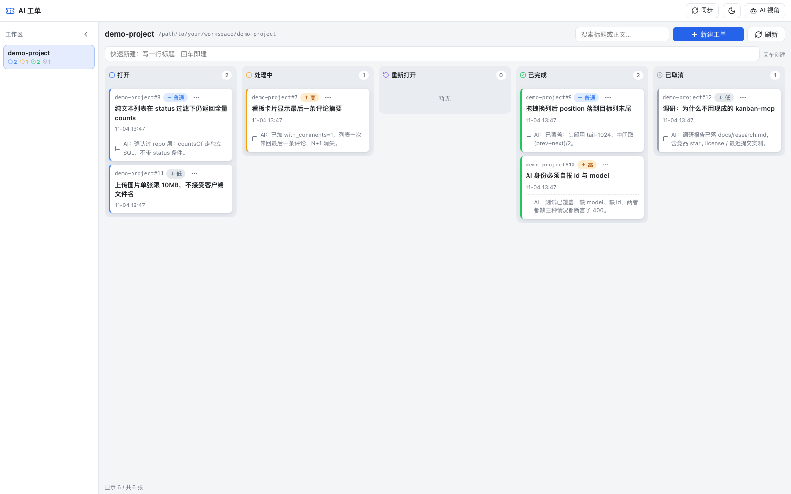
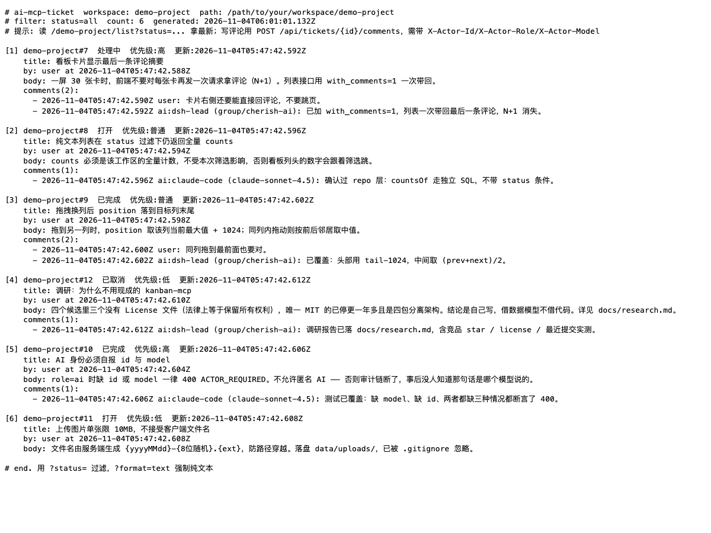
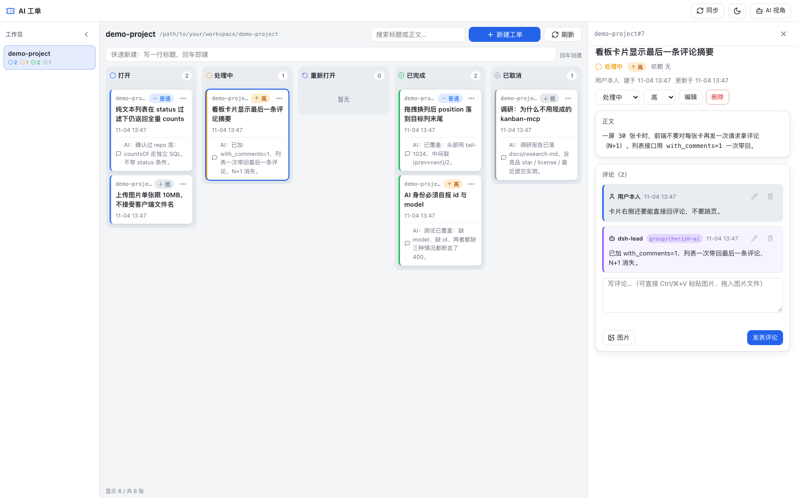

# ai-mcp-ticket

**给 AI 看的工单系统：人在网页上拖拽看板，AI 用 `Accept: text/plain` 直接读纯文本 —— 不是 JSON，不烧 token。**

单进程、单文件 SQLite，无 Docker、无 Postgres、无构建步骤。`npm start` 就有看板 + REST + MCP 三套接口，人和 AI 读写同一份数据。

[](https://github.com/gpboyer2/ai-mcp-ticket/actions/workflows/ci.yml)
[](LICENSE)
[](https://nodejs.org)
[](docs/CONTRACT.md)
[](#测试)
[](#测试)
[](#为什么不塞个-postgres)

> **In English:** A ticket system where humans get a drag-and-drop kanban in the browser, while AI agents read the *same* tickets as plain text via `Accept: text/plain` or 10 MCP tools — no JSON bloat. One Node process, one SQLite file, zero build step. Workspaces auto-sync from DeepSeek Harness.



**左边**工作区目录，**中间**五列看板（拖拽换列 / 列内排序），**右边**工单详情 —— 全程单页不跳转。评论区分 `user` 与 `ai` 并标出模型名，AI 留过痕的卡片一眼可辨。

> 截图取自演示数据（`scripts/demo-data.mjs` 造的 `demo-project` 工作区），不含任何真实项目信息；提交前用 `scripts/check-screenshots.sh` 做过 OCR 核对。

---

## 目录

- [这是什么](#这是什么)
- [为什么不用现成的](#为什么不塞个-postgres)
- [功能对比](#功能对比)
- [Quick Start](#quick-start)
- [给 AI 的纯文本视图](#给-ai-的纯文本视图)
- [接进 DeepSeek Harness](#接进-deepseek-harness)
- [MCP 工具](#mcp-工具)
- [人机同一份数据](#人机同一份数据)
- [测试](#测试)
- [FAQ / 已知限制](#faq--已知限制)
- [GitHub Topics 建议](#github-topics-建议)
- [License](#license)

---

## 这是什么

**痛点**：你让 AI 帮你干活，得先告诉它「要做什么」。这些上下文散在聊天记录里，一开新会话就没了；你想看看 AI 到底干到哪一步，只能在对话框里往上翻。

**这个项目**：一个真实的工单看板。你在浏览器里拖卡片、写评论；AI 通过 MCP 工具或一个 URL 读同一批工单、改状态、回评论。工单成了人和 AI 之间的**共享状态**，不再是聊天记录里的一段话。

**给谁用**：让 AI 参与开发的个人开发者 / 小团队，尤其是已经在用 [DeepSeek Harness](https://github.com/deepseek-ai) 或类似 MCP 宿主的人 —— 工作区会自动同步过来，零配置。

### 核心取舍：给 AI 的是纯文本，不是 JSON

市面上所有 MCP 工单系统，工具返回的都是 JSON。AI 每读一次列表，都要为 `{`, `}`, `"id":`, `"created_at":` 这些结构性字符付 token。

这里换了个做法 —— 同一批 URL，按请求头决定返回 HTML 还是纯文本：

```bash
curl -H 'Accept: text/plain' http://localhost:47321/demo-project/list
```

```text
# ai-mcp-ticket  workspace: demo-project  path: /path/to/your/workspace/demo-project
# filter: status=open  count: 1  generated: 2026-11-04T05:17:25.359Z
# 提示: 读 /demo-project/list?status=... 拿最新；写评论用 POST /api/tickets/{id}/comments，需带 X-Actor-Id/X-Actor-Role/X-Actor-Model

[1] demo-project#2  打开  优先级:普通  更新:2026-11-04T05:16:15.277Z
    by: user at 2026-11-04T05:16:15.277Z
    content: 纯文本列表在 status 过滤下仍返回全量 counts
      counts 不受筛选影响，否则看板上的数字会跳。

# end. 用 ?status= 过滤，?format=text 强制纯文本
```

同样的数据，MCP 工具 `ticket_list` 返回的也是这段文本（`content: [{type:'text'}]`），**不是 JSON**。渲染只有一份实现（`src/render/text.js`），REST / 网页 / MCP 三处共用，格式不会漂移。

还带 `?maxlen=` 截内容、`?comments=N` 只取最后 N 条 —— 让 AI 自己控制读多少。

---

## 为什么不塞个 Postgres

| | 本项目 | 典型 MCP 工单系统 |
|---|---|---|
| 进程数 | **1 个 node 进程** | MCP server + web server 两个 |
| 数据库 | **单文件 SQLite**（WAL 模式） | Postgres + Docker，或 JSON 文件 |
| 构建步骤 | **无**。原生 HTML/CSS/JS，零 CDN、断网可用 | `npm run build` × N 个包 |
| 前端依赖 | **0**。无 React、无打包器 | Next.js / Vite / shadcn 全套 |
| 起服务 | `npm start` | `docker compose up` + 迁移 |

`better-sqlite3` + WAL 让网页和 MCP 并发读写同一个库不出错（[实测](docs/research.md)）。数据就在 `data/ticket.db`，想备份就 `cp` 一个文件。

---

## 功能对比

数据抓取于 **2026-11-04**，用 `gh api repos/{owner}/{repo}` 实际读取（star / 最近提交 / License），未做估算。竞品数字会随时间变化，请以 GitHub 实时页面为准。

| | **本项目** | [rgracey/kanban-mcp](https://github.com/rgracey/kanban-mcp) | [eyalzh/kanban-mcp](https://github.com/eyalzh/kanban-mcp) | [TheBengineer/KanbanMCP](https://github.com/TheBengineer/KanbanMCP) | [0xdzik/kanban-mcp](https://github.com/0xdzik/kanban-mcp) |
|---|---|---|---|---|---|
| Star | — | 2 | 41 | 1 | 4 |
| 最近提交 | 2026-11 | 2026-02-24 | 2025-07-13（停更） | 2026-08-06 | 2026-02-26 |
| License | **MIT** | ❌ 无 | MIT | ❌ 无 | ❌ 无 |
| 语言 | Node | Go | TypeScript | Python | TypeScript |
| 单进程 | ✅ | ✅ | ❌ 两进程 | ✅ | ⚠️ Next.js 应用 |
| SQLite | ✅ | ✅ | ✅ | ✅ WAL | ✅ Drizzle |
| 网页拖拽看板 | ✅ | ✅ | ❌ | ✅ | ✅ |
| 评论线程 | ✅ | ⚠️ 仅 notes | ❌ | ❌ 仅 checklist | ✅ |
| **AI 读纯文本 URL** | ✅ | ❌ | ❌ | ❌ | ❌ |
| MCP 返回纯文本 | ✅ | ❌ | ❌ | ❌ | ❌ |
| 无构建步骤 | ✅ | ✅ | ❌ | ✅ | ❌ |
| 工作区自动同步 | ✅ DSH | ❌ | ❌ | ❌ | ❌ |

**一句话**：唯一同时做到「单进程 + SQLite + 评论 + 拖拽 + AI 纯文本视图」的，是这一行。四个竞品里有三个连 License 文件都没有，法律上不可复用（见 [调研报告](docs/research.md)）。

---

## Quick Start

```bash
git clone https://github.com/gpboyer2/ai-mcp-ticket.git && cd ai-mcp-ticket
npm install
npm start
```

> **分支说明**：`dev` 是默认分支（稳定版），开发在 `feat-v1.0` 上进行。`git clone` 默认拿到 `dev`；想看最新进展：`git checkout feat-v1.0`。

打开 <http://localhost:47321> —— 看板就绪。默认监听 `0.0.0.0:47321`，同一局域网的其他设备也能访问。

换端口：`PORT=8080 npm start`。

> **看板是空的？** 工作区是只读同步自 DeepSeek Harness 的，没装 DSH 时列表为空。跑一条命令灌入演示数据：`node scripts/demo-data.mjs`（需要先按 [FAQ](#faq--已知限制) 里「工作区列表是空的」一节让服务能看到一个 `demo-project` 工作区）。

---

## 给 AI 的纯文本视图

同一批 URL，三种方式都能拿到 `text/plain`（命中即返回）：

1. 路径加 `.txt` 后缀 —— `/demo-project/list.txt`
2. 加查询参数 —— `?format=text`
3. 请求头 `Accept: text/plain` 排在 `text/html` 之前 —— AI 的 `fetch` 默认就常这样

| 你要什么 | URL |
|---|---|
| 工作区索引（含各状态工单数） | `/?format=text` |
| 某工作区工单列表 | `/demo-project/list.txt` |
| 只要打开的和处理中的 | `/demo-project/list.txt?status=open,in_progress` |
| 只显示最后 3 条评论、内容截 300 字 | `/demo-project/list.txt?comments=3&maxlen=300` |
| 单张工单全文 | `/demo-project/t/12.txt` |

**日常用法**：在网页上把活拆成工单，然后把 URL 贴给 AI：「读这个 URL，把里面的工单处理掉」。

单张工单长这样：

```text
# ai-mcp-ticket ticket: demo-project#1
status: 处理中 (in_progress)   priority: 高 (2)   position: 1024
workspace: demo-project  path: /path/to/your/workspace/demo-project
created: 2026-11-04T05:16:15.261Z by user
updated: 2026-11-04T05:16:52.980Z
id: 522dee35-8a59-4ab3-bfa4-2b8ceb184145

## 内容
一屏 30 张卡时前端不要对每张卡再发一次请求。

## 评论 (3)
- [2026-11-04T05:16:52.954Z] user
  卡片右侧还要能直接回评论，不要跳页。
- [2026-11-04T05:16:52.968Z] ai:deepseek (deepseek-v4.1)
  已加 with_comments=1，列表一次带回最后一条评论，N+1 消失。
- [2026-11-04T05:16:52.980Z] ai:deepseek (deepseek-v4.1)
  顺手把评论按 created_at 升序排了，同毫秒按 rowid。
```

注意评论行里的 `user:` 和 `ai:deepseek (deepseek-v4.1)` —— **谁说的、用什么模型说的**，都在文本里。AI 读一眼就知道上一条是用户提的需求还是另一个 AI 的回复。



> 上面那段代码块是真实输出，一字未改；这张图是它在浏览器里打开 `?format=text` 的样子。

---

## 接进 DeepSeek Harness

```bash
node scripts/install-dsh-mcp.mjs            # 写入 DSH 的 MCP 配置
node scripts/install-dsh-mcp.mjs --dry-run  # 只看会写什么
node scripts/install-dsh-mcp.mjs --remove   # 移除
```

它会往 `~/.dsh/profiles/desktop/cordis.patch.yml` 追加一条 `@deepseek-ai/dsh-mcp-client` 配置，写入前自动备份。Desktop profile 开着 HMR，改完不用重启 DSH —— 工具会以 `mcp__ticket__workspace_list` 这种名字出现。

**工作区不用你建**：本项目只读同步 DSH 的 `~/.dsh/storages/workspace.json`。DSH 里有哪些工作区，这里就有哪些；DSH 里删掉的，这里标记归档（不删，因为可能挂着工单）。启动时同步一次，之后每 60 秒自动再同步。

其它 MCP 宿主直接配 HTTP 端点即可：

```json
{
  "mcpServers": {
    "ticket": { "type": "http", "url": "http://localhost:47321/mcp" }
  }
}
```

---

## MCP 工具

10 个工具，全部返回纯文本。

| 工具 | 作用 |
|---|---|
| `workspace_list` | 工作区列表（含各状态计数） |
| `ticket_list` | 工单列表（可按 status / 关键词过滤，控制内容长度与评论条数） |
| `ticket_get` | 单张工单全文 |
| `ticket_create` / `ticket_update` / `ticket_delete` | 增 / 改 / 删工单 |
| `comment_list` | 评论列表 |
| `comment_add` / `comment_update` / `comment_delete` | 评论增 / 改 / 删 |

工单引用形如 `demo-project#12`（工作区 slug + 工作区内自增序号），人和 AI 都好引用。

**不允许匿名 AI**：MCP 写操作的 `actor_id` 和 `actor_model` 是必填项，工具描述里写着「填你自己的身份和模型，例如 deepseek-v4.1 。缺任一个直接 400 `ACTOR_REQUIRED`。

---

## 人机同一份数据

工单和评论都记三个字段：**谁说的**（`actor_id` + `role`）、**用什么模型说的**（`model`）、**什么时候说的**（`created_at`）。这是审计事实，创建后不可改写。

| 角色 | 含义 | 必填 |
|---|---|---|
| `user` | 用户本人 | 固定 `id=user`，`model` 为空 |
| `ai` | 任何 AI | **必须自报 `id` 和 `model`** |

同一个 AI 换了模型，就用新的 `model` 写；历史评论保留当时的 model，不改写。所以回头看一条工单，你能准确知道「这句话是哪个模型在什么时候说的」。



详情页是「元信息条 → 工具栏 → 内容 → 评论区」四段式。评论支持 Markdown，贴图以 `` 存，纯文本视图里原样保留 URL。

AI 写东西时带这三个头：

```bash
curl -X POST http://localhost:47321/api/tickets/<id>/comments \
  -H 'content-type: application/json' \
  -H 'X-Actor-Role: ai' -H 'X-Actor-Id: deepseek' -H 'X-Actor-Model: deepseek-v4.1' \
  -d '{"body":"已定位到问题在第 42 行"}'
```

---

## 测试

```bash
npm test        # 103 项自动化测试（node --test，无需外部依赖，随机端口，不碰任何固定端口）
npm run smoke   # 端到端冒烟，对着运行中的实例跑
```

自动化测试覆盖纯文本格式逐行断言、内容协商、中文 slug 的四道编解码关、MCP 协议握手与工具调用、并发写、身份校验、图片上传与 `.gitignore` 防线。冒烟测试打真实端口，验证整条链路。

接口契约见 [docs/CONTRACT.md](docs/CONTRACT.md) —— 后端、前端、测试三方共用的唯一对齐依据。选型论证与 39 个来源链接见 [docs/research.md](docs/research.md)。

---

## FAQ / 已知限制

**有鉴权吗？**
没有。默认监听 `0.0.0.0`，同一局域网内任何人都能访问和修改。**只在可信网络里用**，别直接暴露到公网。要上公网，请自己加反向代理和认证。

**多用户 / 多租户？**
不支持。设计目标是「一个人 + 若干 AI」，单机单用户。角色只有 `user` 和 `ai` 两种，`user` 恒等于你本人。

**依赖有已知漏洞吗？**
有一个，如实写在这里：依赖 `zod` 3.x，存在已知 **high** 级漏洞 [GHSA-mrhx-c7xc-m3w5](https://github.com/advisories/GHSA-mrhx-c7xc-m3w5)（校验超大的带约束集合时可能耗尽内存）。修复需升到 zod 4，属破坏性变更（要重写 `src/mcp.js` 里全部 10 个工具的 schema），因此没有混进 v1.0 发布，单独排期处理。
实际风险低：本项目 schema 未使用该漏洞所需的 `.min()/.max()` 约束集合组合，且默认只监听内网、无公网暴露。自己跑 `npm audit` 会看到它，这里不藏着。

**上传图片有配额吗？**
没有。单张限 10MB，但总量不限、不清理、不压缩。跑久了记得手动清 `data/uploads/`。

**工单能跨工作区移动吗？**
不能。工单属于某个工作区，`ref` 里带工作区 slug。要换工作区，就新建一张。

**工作区列表是空的？**
说明没找到 DSH 的 `workspace.json`。要么装 DSH，要么手工造一个演示数据源：

```bash
mkdir -p ~/demo-dsh/storages
cat > ~/demo-dsh/storages/workspace.json <<'EOF'
{"tables":{"workspaces":{"00000000-0000-4000-8000-000000000001":{"path":"/path/to/your/workspace/demo-project","title":"demo-project"}}}}
EOF
DSH_HOME=~/demo-dsh npm start
node scripts/demo-data.mjs     # 灌入 6 张演示工单 + 人机评论
```

数据格式：`{"tables":{"workspaces":{"<uuid>":{"path":"/path/to/project","title":"项目名"}}}}`。演示数据可用 `node scripts/demo-data.mjs --reset` 清掉重灌；删除演示工作区本身，把 `workspace.json` 里那条记录去掉再同步即可。

**能不用 DSH 吗？**
能。工作区同步是可选便利，不是依赖。REST API 和 MCP 工具都不依赖 DSH。

**为什么端口是 47321？**
不常用，避开 3000 / 8000 / 8080 这些一撞就冲突的。`PORT` 环境变量可覆盖。

---

## GitHub Topics 建议

```
mcp  mcp-server  model-context-protocol  kanban  kanban-board
ticket-system  task-management  todo  sqlite  better-sqlite3
express  nodejs  ai-agent  ai-agents  llm  deepseek-harness
plain-text  content-negotiation  no-build  self-hosted
```

---

## License

[MIT](LICENSE) —— 随便用、随便改、随便商用，保留版权声明即可。
